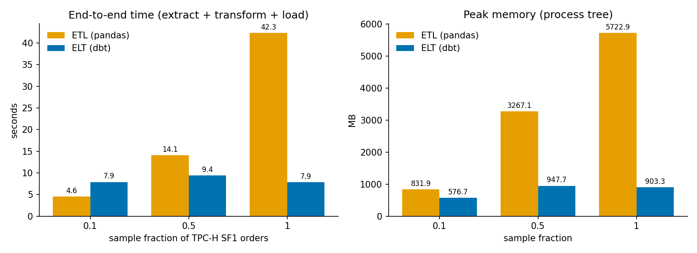
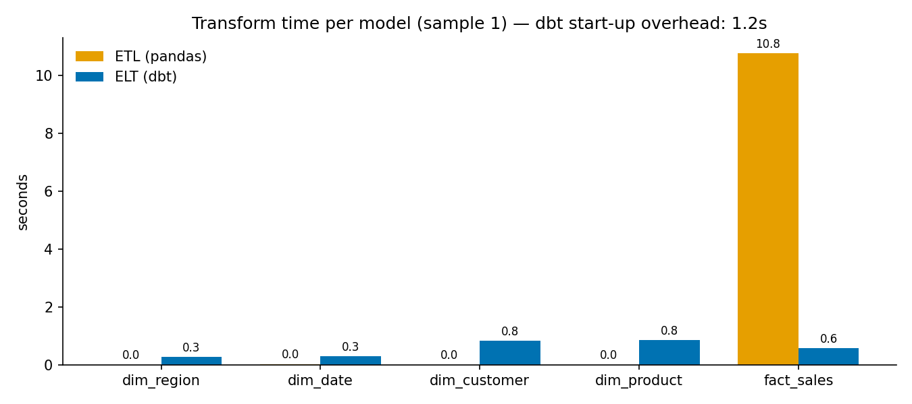

# ETL vs ELT: pandas vs dbt on TPC-H


The same star schema is built twice from the TPC-H benchmark dataset:

* **ETL**: extract Parquet into **pandas**, transform in Python, load into DuckDB.
* **ELT**: load the raw Parquet into **DuckDB**, then transform in-database with **dbt** models.

The two are compared on speed, memory, data-quality testing, code complexity and lineage.
Both pipelines are verified to produce **identical tables** before any number is reported.

## Results (TPC-H SF 1, ~6M line items)



| Orders sampled | ETL (pandas) | ELT (dbt + DuckDB) | Peak memory ETL / ELT |
|---|---|---|---|
| 10 % (600k line items) | **4.6 s** | 7.9 s | 0.8 GB / 0.6 GB |
| 50 % (3M line items)   | 14.1 s | **9.4 s** | 3.3 GB / 0.9 GB |
| 100 % (6M line items)  | 42.3 s | **7.9 s** | 5.7 GB / **0.9 GB** |

**Takeaways**

1. **ELT wins as soon as data stops being small.** On the full dataset it's ~5× faster and
   uses ~6× less memory. DuckDB runs the joins vectorised, multi-threaded and out-of-core,
   while pandas materialises every intermediate DataFrame in RAM.
2. **ETL wins on small data.** Below a few hundred thousand rows, dbt's fixed costs
   dominate: about 1.2–2.7 s to start and parse the project per `dbt run`, plus ~0.3 s of
   materialisation per model.
3. **ETL's cost is mostly I/O, not transforms.** At 100 %, the pandas transforms take ~11 s
   (the `fact_sales` merges) out of 42 s. The rest is reading Parquet into DataFrames and
   writing them back to DuckDB, work that ELT never does.
4. **Testing is where dbt shines for maintainability.** The same 29 data-quality tests
   (not-null, unique, accepted values, relationships) take ~100 lines of YAML in dbt, which
   also documents every column, vs. ~200 lines of hand-written pandas test code. dbt also
   generates lineage and docs for free.

Full numbers: [`docs/results.md`](docs/results.md). Per-model transform times:



## Methodology

* **Data**: TPC-H generated with DuckDB's `tpch` extension at SF 1, exported to Parquet.
* **Same input for both sides**: samples are drawn once by hashing `o_orderkey`, and line
  items follow their order, so referential integrity is preserved and both pipelines read
  exactly the same files (`data/samples/f<fraction>/`).
* **Same output**: `python main.py verify` compares row counts and column fingerprints of
  every table in both databases. Tests enforce this in CI.
* **Timing**: wall-clock and CPU time (including child processes) of the whole
  extract-transform-load step. dbt is invoked once per run; per-model times come from
  dbt's `run_results.json`, and start-up overhead is reported separately. An untimed
  `dbt parse` warm-up runs first.
* **Memory**: a background thread samples the RSS of the **whole process tree** every
  20 ms. This matters: dbt runs DuckDB in a subprocess, so measuring only the parent
  process would make ELT look free.
* **Isolation**: each sample fraction runs in a fresh Python process; everything runs in
  Docker on Linux (8 GB RAM, 16 vCPUs) for reproducibility.

**Limits.** Each configuration is a single run: times vary by ±25 % between runs (e.g. ETL
at 100 % took 42–57 s across runs), but the ranking and the orders of magnitude are stable.
dbt per-model times include writing the table, while ETL per-table transform times
exclude the load step, so compare the end-to-end numbers. pandas uses a single core by
design. Polars or DuckDB's Python API would be the fairer "modern ETL" opponent and is a
natural next experiment.

## Reproduce

```bash
docker build -t etl-vs-dbt .
docker run --rm -v "$PWD/results:/out" etl-vs-dbt      # ~5 min: generate, sample, run, verify, report
```

Or locally (Python 3.11+):

```bash
pip install -r requirements.txt
python main.py all --sf 1        # or step by step:
python main.py generate --sf 1   # TPC-H → Parquet
python main.py samples           # shared samples (10 %, 50 %, 100 %)
python main.py etl && python main.py elt
python main.py verify            # identical outputs?
python main.py tests             # 29 data-quality tests on each side
python main.py report            # docs/*.png + docs/results.md
```

## Project layout

```
etl_project/etl.py          ETL: pandas extract → transform → DuckDB load (+ timing harness)
etl_project/etl_tests.py    the 29 data-quality checks, hand-written in pandas
dbt_project/models/marts/   ELT: one SQL model per table + schema.yml (docs + 29 tests)
dbt_project/analyses/       analytical queries (same SQL as the ETL side)
dbt_project/dbt.py          ELT runner + timing harness
scripts/dbgen.py            TPC-H generation and shared sampling
verify.py                   output equivalence check
utils.py                    benchmark helpers (process-tree memory sampler)
complexity.py, lineage.py   code complexity (radon) and lineage/documentation comparison
report.py                   charts and results table
tests/                      pytest: sampling integrity, output equivalence, memory measurement
```
